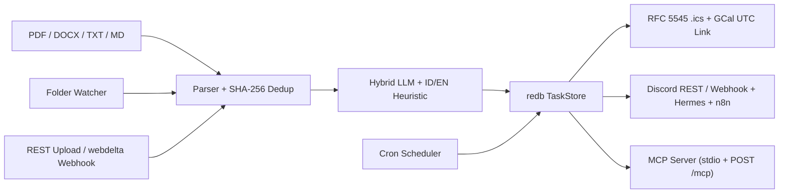

# academic-agent

[](https://github.com/luminariadev/academic-agent/actions/workflows/ci.yml)
[](https://github.com/luminariadev/academic-agent/releases)
[](LICENSE)
[](https://www.rust-lang.org)
[](docs/mcp.md)

A single-binary Rust assistant for ingesting academic documents, extracting assignments and deadlines, synchronizing timezone-accurate `.ics` calendars, running cron deadline reminders, dispatching Discord and Hermes notifications, and exposing task management over the Model Context Protocol (MCP).

## Why academic-agent

Syllabi, lecture PDFs, DOCX assignment sheets, and portal announcements arrive in inconsistent formats and frequently lead to missed deadlines. `academic-agent` consolidates ingestion, extraction, scheduling, and reminders into one native binary with an embedded database:

- **Multi-format document ingestion**: parses `.pdf` (pure-Rust `lopdf`), `.docx` paragraphs and tables (`zip` + `quick-xml`), `.txt`, and `.md` files from CLI commands, folder watching (tracking both create and move/rename events), multipart HTTP uploads, and signed `webdelta` webhooks.
- **Hybrid bilingual extractor**: queries any Chat Completions HTTP gateway for structured task extraction and falls back deterministically to a bilingual Indonesian and English heuristic parser (`15 Juli 2026`, `July 15, 2026`, `DD/MM/YYYY`, ISO timestamps) when offline.
- **Timezone-accurate calendars**: generates RFC 5545 `.ics` files with dual reminders (`-P1D` and `-PT1H`) and 1-click Google Calendar links converted accurately from your configured IANA timezone (for example `Asia/Jakarta`) to UTC.
- **Embedded `redb` task store with deduplication**: computes SHA-256 content hashes inside ACID transactions so re-scanning or re-uploading the same document never duplicates tasks, calendars, or alerts.
- **Cron reminder and digest scheduler**: dispatches a scheduled local-time daily digest plus tiered deadline alerts (default `H-72h`, `H-24h`, `H-3h`, and `OVERDUE`) with anti-spam persistence and per-task snoozing.
- **Discord and Hermes integration**: sends structured embeds (and Google Calendar action buttons in Bot mode) over Discord REST v10 or Webhooks with HTTP `429 Retry-After` backoff, plus optional configurable `hermes` CLI dispatch and outbound signed n8n webhooks.
- **Built-in MCP server**: serves 8 MCP tools and 4 read-only `academic://` resources over `stdio` or Streamable HTTP (`POST /mcp`).

## Architecture



## Installation

### Build from Source

Requires Rust 1.82 or newer:

```bash
git clone https://github.com/luminariadev/academic-agent.git
cd academic-agent
cargo install --path crates/academic-cli
```

## Quickstart

Create a starter `academic-agent.toml` configuration and validate it:

```bash
academic-agent init
academic-agent validate
```

Copy or inspect the sample files in `examples/` and scan an assignment offline using the bilingual heuristic extractor:

```bash
academic-agent scan examples/sample_assignment.txt --heuristic
academic-agent tasks
academic-agent upcoming --hours 72
```

Run the folder watcher on `inbox/`, test extraction or Discord connectivity, or evaluate scheduled reminders:

```bash
academic-agent watch
academic-agent test-ai --file examples/sample_syllabus.md --heuristic
academic-agent test-discord
academic-agent cron-tick --dry-run
```

Start the Axum REST API, `webdelta` webhook receiver, background cron scheduler, folder watcher, and Streamable HTTP `/mcp` server together:

```bash
academic-agent serve --bind 127.0.0.1:8080 --with-cron --with-watch
```

## Configuration Example

```toml
[general]
inbox_dir = "inbox"
archive_dir = "archive"
calendar_dir = "data/calendar"
db_path = "data/state.redb"
timezone = "Asia/Jakarta"
backup_processed = true
default_duration_hours = 2

[llm]
api_base = "${ACADEMIC_LLM_API_BASE}"
api_key = "${ACADEMIC_LLM_API_KEY}"
model = "gpt-4o-mini"
fallback_to_heuristic = true

[discord]
enabled = true
mode = "auto"
bot_token = "${DISCORD_BOT_TOKEN}"
channel_id = "${DISCORD_CHANNEL_ID}"
webhook_url = "${DISCORD_WEBHOOK_URL}"

[cron]
enabled = true
digest_cron = "0 7 * * *"
reminder_hours = [72, 24, 3]
alert_overdue = true
```

See [docs/configuration.md](docs/configuration.md) for every field and environment variable.

## CLI Reference

Global flags: `--config <PATH>` (default `academic-agent.toml`), `--db <PATH>`, `--json`, and `--verbose` (`-v`).

| Command | Purpose |
| :--- | :--- |
| `academic-agent init [--force]` | Write a starter `academic-agent.toml` file. |
| `academic-agent validate` | Validate TOML syntax, timezone, cron schedule, and endpoint URLs. |
| `academic-agent scan <file> [--heuristic] [--notify]` | Parse, deduplicate, extract task metadata, generate `.ics`, and optionally notify. |
| `academic-agent watch` | Watch `inbox_dir` for newly created or moved/renamed documents. |
| `academic-agent tasks [--status S] [--export json\|csv]` | List tracked tasks or export them as JSON or CSV. |
| `academic-agent upcoming [--hours 72]` | List incomplete tasks due within N hours (including overdue). |
| `academic-agent done <id>` | Mark a task as `COMPLETED`. |
| `academic-agent status <id> <status>` | Set task status (`PENDING`, `IN_PROGRESS`, `COMPLETED`, `ARCHIVED`). |
| `academic-agent snooze <id> [--hours 24]` | Suppress scheduled reminders for a task for N hours. |
| `academic-agent delete <id>` | Delete a task and clear its deduplication hash. |
| `academic-agent digest [--send]` | Preview (`dry-run` default) or dispatch an open-task summary digest. |
| `academic-agent cron-tick [--dry-run]` | Run one scheduled reminder and digest evaluation pass. |
| `academic-agent test-ai [--text T] [--file F]` | Run structured extraction without persisting state. |
| `academic-agent test-discord` | Send a synthetic verification embed via Discord or Hermes. |
| `academic-agent serve [--bind B] [--with-cron] [--with-watch]` | Start REST API, `webdelta` webhook endpoint, background loops, and `/mcp`. |
| `academic-agent mcp [--http <bind>] [--token <secret>]` | Run MCP over `stdio` or standalone Streamable HTTP. |

## Discord, Hermes, n8n, and webdelta

- **Discord and Hermes**: see [docs/discord-and-hermes.md](docs/discord-and-hermes.md) for configuring Bot REST API v10 (with 1-click Google Calendar link buttons), Discord Webhooks, `429 Retry-After` retries, and Hermes CLI fallback.
- **n8n and webdelta integration**: see [docs/webhooks-n8n.md](docs/webhooks-n8n.md) and [workflows/README.md](workflows/README.md) for importing `workflows/academic-agent.n8n.json` and forwarding signed `X-WebDelta-Signature` alerts from `webdelta` directly into `POST /api/webhooks/webdelta`.

## MCP Server

Register the built-in `stdio` MCP server in any MCP-compatible client:

```json
{
  "mcpServers": {
    "academic-agent": {
      "command": "academic-agent",
      "args": ["mcp", "--config", "academic-agent.toml"]
    }
  }
}
```

Tools exposed (`8`): `list_tasks`, `add_task`, `update_status`, `snooze_task`, `scan_document`, `upcoming_deadlines`, `export_ics`, and `send_digest`. Read-only resources exposed (`4`): `academic://tasks`, `academic://upcoming`, `academic://config`, and `academic://calendar/{task_id}`. See [docs/mcp.md](docs/mcp.md).

## Development and Testing

All unit, integration, CLI, MCP, and HTTP E2E tests run offline using local mock HTTP servers and generated in-memory PDF/DOCX documents:

```bash
cargo fmt --all -- --check
cargo clippy --workspace --all-targets -- -D warnings
cargo test --workspace
```

## Roadmap

- **v0.1.0**: Rust workspace overhaul (`academic-core`, `academic-mcp`, `academic-cli`), pure-Rust PDF/DOCX parsing, bilingual LLM/heuristic extraction, UTC-corrected `.ics` and Google Calendar links, `redb` content deduplication, cron reminder/digest scheduler, Discord + Hermes notifiers, Axum REST API with `webdelta` HMAC receiver, and `stdio` + HTTP MCP server.
- **v0.2.0**: Two-way Discord Bot Gateway (slash commands and action buttons), embedded web task dashboard, and optional Playwright LMS connector (`connectors/lms-playwright/`) validated against a simulated campus portal.
- **v0.3.0**: Multi-OS prebuilt release archives with `SHA256SUMS.txt`, non-root Docker GHCR image, Scoop and Homebrew manifests, dashboard screenshots, and measured benchmarks.

## License

MIT. See [LICENSE](LICENSE).
