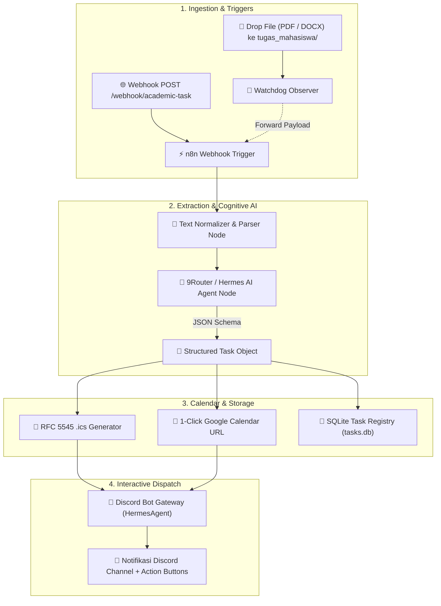

# 🎓 Academic Agent — Hybrid AI Automation Workflow

<div align="center">

[](https://n8n.io)
[](https://github.com/luminariadev/academic-agent)
[](https://github.com/luminariadev/academic-agent)
[](https://python.org)
[](https://discord.com)
[](https://www.docker.com/)
[](https://github.com/luminariadev/academic-agent/actions)
[](LICENSE)

<br/>

**Sistem Otomasi Akademik Cerdas Berbasis n8n, Multi-Agent LLM (9Router / Hermes), Generator Jadwal .ics RFC 5545, dan Bot Notifikasi Interaktif Discord.**

[Fitur Utama](#-fitur-utama) • [Arsitektur Sistem](#-arsitektur-sistem) • [Workflow n8n](#-workflow-n8n) • [Panduan Instalasi](#-panduan-instalasi) • [Penggunaan CLI](#-penggunaan-cli) • [Pengujian](#-pengujian)

</div>

---

## 📌 Ringkasan Masalah & Evolusi Modern

Mahasiswa sering kali kewalahan mengelola tumpukan silabus, modul kuliah, dan tugas mingguan yang tersebar di berbagai LMS atau grup chat. Format dokumen acak (PDF instruksi, DOCX silabus) sering berujung pada **terlewatnya batas waktu pengumpulan (deadline)** dan kesulitan memecah tugas besar menjadi langkah-langkah kerja (*sub-tasks*).

Versi awal proyek ini dirancang sebagai *script* monitoring lokal berbasis framework legacy. Kini, **Academic Agent telah direvolusi menjadi arsitektur modern Hybrid AI Automation Workflow** untuk memenuhi standar industri:
1. **n8n Orchestration Core:** Menghilangkan skrip kaku tak terpelihara dengan alur kerja event-driven visual yang tangguh dan siap *self-hosted* atau cloud.
2. **Cognitive Extraction Engine:** Terkoneksi ke LLM canggih via **9Router & Hermes Agent** (OpenAI-compatible) untuk ekstraksi skema JSON berintegritas tinggi.
3. **Automated Calendar Synchronization:** Menghasilkan file kalender standar internasional **RFC 5545 (`.ics`)** dengan *dual alarm reminder* (H-1 dan 1 Jam sebelum batas waktu) serta tautan **1-Click Google Calendar**.
4. **Rich Interactive Discord Dispatch:** Mengirimkan pesan notifikasi interaktif berkancing langsung ke server/channel Discord pengguna melalui Bot Gateway.

---

## ✨ Fitur Utama

- 🔄 **n8n Ready Workflow (`/workflows`):** Template alur kerja JSON siap pakai (*1-click import*) untuk menerima webhook file/dokumen, mengonsumsi LLM API, memformat kalender, dan menembak pesan Discord.
- 🧠 **AI Extraction with 9Router & Hermes:** Mengekstrak secara cerdas: Nama Mata Kuliah, Judul Tugas, Batas Waktu ISO, Tingkat Prioritas, Rangkuman Eksekutif, Estimasi Jam Pengerjaan, dan *Sub-task Checklist*.
- 📂 **Multi-Format Document Parsing:** Mendukung file `.pdf` (pypdf), `.docx` (python-docx), `.txt`, dan Markdown.
- 📅 **Dual Calendar Generation:**
  - File `.ics` universal dengan alarm pengingat otomatis.
  - Tautan tombol langsung *Add to Google Calendar* dengan tanggal dan rincian yang sudah terisi otomatis.
- 💬 **Discord Interactive Bot Integration:** Embed Discord dengan kode warna prioritas (Merah = Tinggi, Kuning = Sedang, Hijau = Rendah), daftar centang sub-task, dan tombol interaksi.
- 📦 **Local Watchdog & REST Bridge:** Service daemon pemantau folder lokal (`tugas_mahasiswa/`) ditambah REST API FastAPI sebagai jembatan dua arah ke n8n.
- 🗄️ **Persistent Task Registry:** Penyimpanan data tugas berbasis SQLite lokal yang aman dan thread-safe.

---

## 🏗️ Arsitektur Sistem



---

## 🔄 Workflow n8n

File workflow produksi tersedia di [`workflows/academic-agent.n8n.json`](workflows/academic-agent.n8n.json).

### Alur Node di Kanvas n8n:
1. **Webhook Node (`POST /webhook/academic-task`):** Menerima unggahan dokumen atau teks silabus.
2. **Preprocess Input (Code Node):** Menormalisasi teks dan memastikan sanitasi data.
3. **AI Node (HTTP Request ke 9Router):** Memanggil model (`mr-loverman` / `coding-general`) dengan *zero-shot structured schema*.
4. **Parse & Build Calendar Data (Code Node):** Memvalidasi JSON, menghitung interval tanggal, dan menyusun URL kalender.
5. **Send Discord Interactive Embed (HTTP Request):** Mengirimkan Embed pesan kaya dan Action Row Button ke Discord API.
6. **Respond to Webhook (Respond Node):** Mengembalikan respon status 200 OK dengan data tugas terstruktur.

---

## 🚀 Panduan Instalasi & Menjalankan

### Persyaratan Awal
- **Python 3.11+**
- **Docker & Docker Compose** (jika menggunakan deployment container)
- **9Router / Hermes** berjalan di latar belakang (port `20128` atau API OpenAI)

### 1. Kloning Repositori
```bash
git clone https://github.com/luminariadev/academic-agent.git
cd academic-agent
```

### 2. Konfigurasi Lingkungan (`.env`)
Salin file template `.env.example` menjadi `.env`:
```bash
cp .env.example .env
```
Sesuaikan parameter utama:
```ini
ROUTER_API_BASE=http://127.0.0.1:20128/v1
ROUTER_API_KEY=your_router_api_key_here
ROUTER_MODEL=mr-loverman

DISCORD_BOT_TOKEN=your_discord_bot_token_here
DISCORD_CHANNEL_ID=your_discord_channel_id_here

N8N_PORT=5678
WATCH_FOLDER=./tugas_mahasiswa
```

---

### Cara Menjalankan

#### Opsi A: Menggunakan Docker Compose (n8n + Python Core)
```bash
docker compose up -d
```
- Akses UI n8n di: `http://localhost:5678`
- Akses Academic Agent REST API di: `http://localhost:8000/docs`

#### Opsi B: Menjalankan Secara Lokal (Python Watchdog Daemon)
```bash
# Buat virtual environment
python -m venv .venv
source .venv/bin/activate  # Untuk Windows: .venv\Scripts\activate

# Install dependensi
pip install -r requirements.txt

# Jalankan daemon pemantau folder
python -m academic_agent.cli watch
```
Cukup letakkan file PDF atau DOCX tugas Anda ke folder `tugas_mahasiswa/`. Dalam hitungan detik, notifikasi interaktif akan muncul di channel Discord Anda!

---

## 💻 Penggunaan CLI

Academic Agent dilengkapi antarmuka CLI yang kaya fitur untuk pengujian dan otomasi skrip:

```bash
# 1. Pindai dan proses satu file dokumen tugas
python -m academic_agent.cli scan sample_docs/tugas_metode_penelitian.pdf

# 2. Uji koneksi AI ke 9Router Gateway
python -m academic_agent.cli test-ai

# 3. Uji pengiriman embed notifikasi ke Discord
python -m academic_agent.cli test-discord

# 4. Tampilkan daftar seluruh tugas aktif
python -m academic_agent.cli tasks

# 5. Filter tugas yang masih PENDING
python -m academic_agent.cli tasks --status PENDING

# 6. Tandai tugas telah selesai
python -m academic_agent.cli done 1

# 7. Jalankan REST API Webhook Server (FastAPI)
python -m academic_agent.cli serve --port 8000
```

---

## 🧪 Pengujian & CI/CD

Proyek ini memiliki cakupan pengujian unit komprehensif menggunakan `pytest` untuk memastikan stabilitas parser, generator RFC 5545, aturan fallback, serta validitas node n8n:

```bash
# Jalankan seluruh test suite
pytest tests/ -v
```

Hasil pengujian otomatis:
```text
tests/test_agent.py::test_clean_json_response PASSED
tests/test_agent.py::test_fallback_rule_based_extraction PASSED
tests/test_agent.py::test_analyze_document_with_fallback PASSED
tests/test_calendar.py::test_parse_deadline_formats PASSED
tests/test_calendar.py::test_create_ics_event PASSED
tests/test_calendar.py::test_google_calendar_url_length PASSED
tests/test_calendar.py::test_escape_ics PASSED
tests/test_parser.py::test_extract_pdf PASSED
tests/test_parser.py::test_extract_docx PASSED
tests/test_parser.py::test_extract_txt PASSED
tests/test_parser.py::test_extract_nonexistent_file PASSED
tests/test_task_db.py::test_task_crud PASSED
tests/test_workflow.py::test_n8n_workflow_file_exists PASSED
tests/test_workflow.py::test_n8n_workflow_structure PASSED
tests/test_workflow.py::test_n8n_workflow_connections PASSED

======================== 15 passed in 0.52s ========================
```

---

## 📁 Struktur Direktori

```text
academic-agent/
├── .github/
│   └── workflows/
│       └── ci.yml               # GitHub Actions CI automated pipeline
├── workflows/
│   ├── academic-agent.n8n.json # Template n8n visual automation workflow
│   └── README.md                # Panduan integrasi & webhook n8n
├── academic_agent/
│   ├── __init__.py
│   ├── config.py                # Konfigurasi lingkungan & direktori
│   ├── parser.py                # Ekstraktor multi-format (PDF, DOCX, TXT)
│   ├── agent.py                 # AI Cognitive Core (9Router / Hermes / OpenAI)
│   ├── calendar_sync.py         # RFC 5545 .ics generator & 1-Click GCal URL
│   ├── discord_notifier.py      # Discord Bot Embeds & Action Components
│   ├── task_db.py               # SQLite Task Registry & Status Manager
│   ├── watcher.py               # Watchdog daemon pemantau folder
│   ├── server.py                # FastAPI REST API & Webhook Bridge
│   └── cli.py                   # Antarmuka CLI manajemen tugas
├── sample_docs/
│   ├── tugas_metode_penelitian.pdf
│   ├── tugas_kecerdasan_buatan.docx
│   └── pengumuman_kuis.txt
├── data/
│   └── calendar/                # Penyimpanan file kalender .ics
├── tests/
│   ├── test_parser.py
│   ├── test_calendar.py
│   ├── test_agent.py
│   ├── test_task_db.py
│   └── test_workflow.py
├── docker-compose.yml           # Orkestrator n8n & Academic Agent container
├── Dockerfile                   # Multi-stage production container
├── requirements.txt             # Dependensi Python produksi
├── requirements-dev.txt         # Dependensi testing & tooling
├── .env.example                 # Template variabel lingkungan
├── LICENSE                      # Lisensi MIT
└── README.md                    # Dokumentasi utama proyek
```

---

## 📄 Lisensi

Didistribusikan di bawah Lisensi **MIT**. Lihat file [`LICENSE`](LICENSE) untuk informasi lebih lanjut.

---

<div align="center">
  <sub>Dikembangkan dengan ❤️ oleh <a href="https://github.com/luminariadev">luminariadev</a> • Arsitektur Modern n8n & Agentic Automation</sub>
</div>
