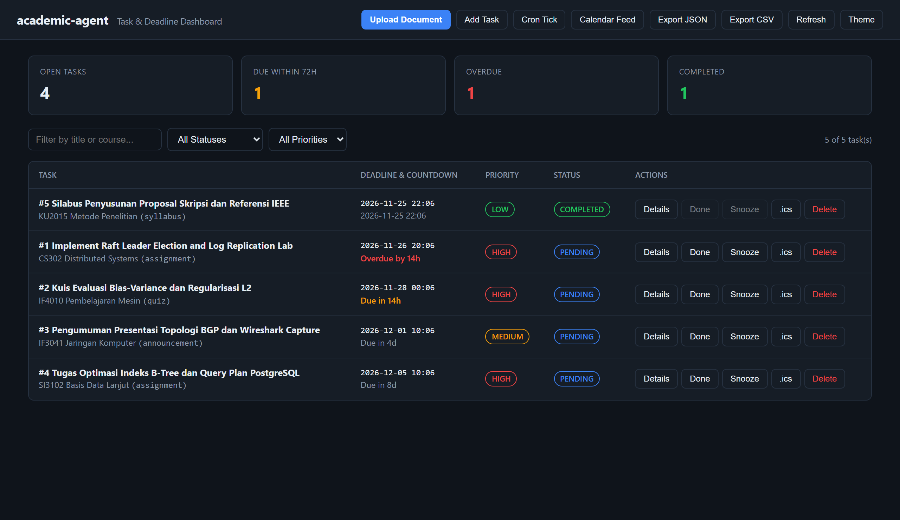
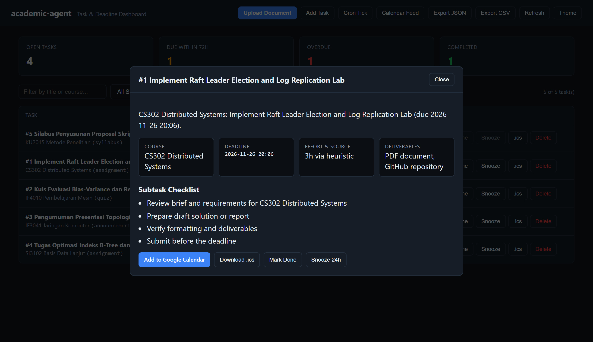
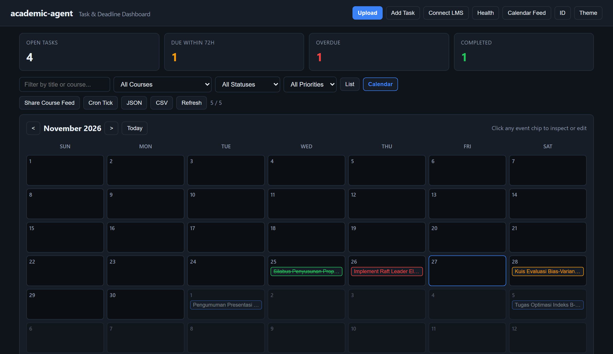
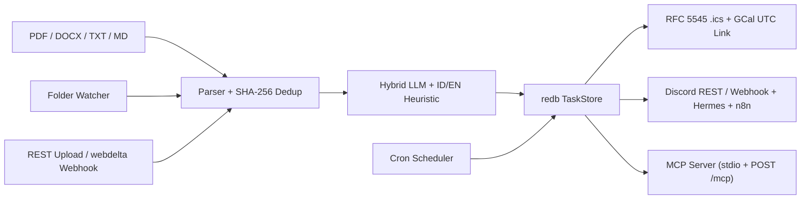

# academic-agent

[](https://github.com/luminariadev/academic-agent/actions/workflows/ci.yml)
[](https://github.com/luminariadev/academic-agent/releases)
[](https://github.com/luminariadev/academic-agent/pkgs/container/academic-agent)
[](LICENSE)
[](https://www.rust-lang.org)
[](docs/mcp.md)

A single-binary Rust assistant for ingesting academic documents, extracting assignments and deadlines, publishing timezone-accurate `.ics` calendars and live iCalendar feeds, running cron deadline reminders, dispatching two-way Discord and Hermes notifications, and exposing task management over the Model Context Protocol (MCP).

## Why academic-agent

Syllabi, lecture PDFs, DOCX assignment sheets, and portal announcements arrive in inconsistent formats and frequently lead to missed deadlines. `academic-agent` consolidates ingestion, extraction, scheduling, and reminders into one native binary with an embedded database:

- **Three-path campus LMS integration**: ingests RFC 5545 `.ics` calendar feeds (Moodle/SPADA, Canvas, Google Classroom) with HTTP `ETag`/`If-Modified-Since` (`304 Not Modified`) caching and single-transaction `redb` batch upserts, connects to Moodle Web Services and Canvas REST APIs natively, or bridges custom SIAKAD/university portals via `connectors/lms-playwright/`.
- **Guided onboarding and health diagnostics**: includes an interactive role wizard (`academic-agent setup` for students, lecturers, or campus IT; `serve --init-if-missing`), 8-subsystem diagnostics (`academic-agent doctor`, `GET /api/doctor`) with URL token redaction, and `academic-agent lms list|sync`.
- **Multi-format document ingestion**: parses `.pdf` (pure-Rust `lopdf`), `.docx` paragraphs and tables (`zip` + `quick-xml`), `.txt`, and `.md` files from CLI commands, folder watching (tracking both create and move/rename events), multipart HTTP uploads, and signed `webdelta` webhooks.
- **Hybrid bilingual extractor**: queries any Chat Completions HTTP gateway for structured task extraction and falls back deterministically to a bilingual Indonesian and English heuristic parser (`15 Juli 2026`, `July 15, 2026`, `DD/MM/YYYY`, ISO timestamps) when offline.
- **Timezone-accurate calendars and live subscription feed**: generates RFC 5545 `.ics` files with dual reminders (`-P1D` and `-PT1H`), 1-click Google Calendar links converted accurately from your configured IANA timezone (for example `Asia/Jakarta`) to UTC, plus a live `GET /api/calendar/feed.ics` subscription endpoint (with `?token=`, `?course=`, and `?include_completed=`) and CLI `calendar-feed`.
- **Embedded `redb` task store with deduplication**: computes SHA-256 content hashes inside ACID transactions so re-scanning or re-uploading the same document never duplicates tasks, calendars, or alerts, while updating shifted deadlines cleanly.
- **Cron reminder and digest scheduler**: dispatches a scheduled local-time daily digest plus tiered deadline alerts (default `H-72h`, `H-24h`, `H-3h`, and `OVERDUE`) with anti-spam persistence and per-task snoozing.
- **Bilingual campus web dashboard**: serves a self-contained `ID`/`EN` dark/light task management UI at `GET /` with `List` and `Calendar` monthly views, dynamic course filtering and **Share Course Feed**, drag-and-drop uploads, Task Edit modal, interactive subtask checkboxes, **Connect LMS** sync modal, and **Health** (`doctor`) diagnostics.
- **Two-way Discord and Hermes integration**: sends structured embeds with interactive **Mark Done**, **Snooze 24h**, and **Add to Google Calendar** buttons over Discord REST v10 or Webhooks (`429 Retry-After` backoff), handles slash commands (`/tasks`, `/upcoming`, `/done`, `/snooze`, `/add`, `/digest`) and button callbacks over Discord Gateway (`intents: 0`), plus optional `hermes` CLI dispatch and outbound signed n8n webhooks.
- **Optional Playwright LMS connector**: bridges JavaScript-heavy custom SIAKAD portals into `academic-agent serve` via [connectors/lms-playwright/](connectors/lms-playwright/README.md) with an automated selector `discover` wizard, ready templates (`siakad-custom`, `spada-moodle`, `canvas`), persistent session cookies, and an offline simulated campus portal.
- **Built-in MCP server**: serves 10 MCP tools and 5 read-only `academic://` resources (`academic://calendar/feed` included) over `stdio` or Streamable HTTP (`POST /mcp`).

## Dashboard Preview

Interactive bilingual web dashboard (`GET /`) showing the overview table, task detail checklist modal, and monthly deadline calendar grid:



*Overview table with live urgency countdowns, subtask completion counts, course filtering, Share Course Feed export, and bilingual controls.*



*Task detail modal inspecting deliverables, interactive subtask checklist checkboxes, Task Edit button, Google Calendar link, and `.ics` download.*



*Monthly calendar view highlighting today, overdue, urgent, and completed deadline chips across courses.*

## Architecture



## Installation

### Prebuilt Binaries

Download standalone archives for Linux (`x86_64`), Windows (`x86_64`), and macOS (`x86_64` and Apple Silicon) with `SHA256SUMS.txt` from [GitHub Releases](https://github.com/luminariadev/academic-agent/releases).

### Scoop (Windows)

```powershell
scoop install https://raw.githubusercontent.com/luminariadev/academic-agent/main/packaging/scoop/academic-agent.json
```

### Homebrew (macOS and Linux)

```bash
brew install --formula https://raw.githubusercontent.com/luminariadev/academic-agent/main/packaging/homebrew/academic-agent.rb
```

### Docker and GHCR

Pull the multi-stage non-root image from GitHub Container Registry or build locally with Compose (see [docs/docker.md](docs/docker.md)):

```bash
docker pull ghcr.io/luminariadev/academic-agent:latest
docker run -d -p 8080:8080 -v "$(pwd)/data:/data" ghcr.io/luminariadev/academic-agent:latest
```

See [docs/distribution.md](docs/distribution.md) for checksum verification, package manifest updates, and crate publishing order.

### Build from Source

Requires Rust 1.82 or newer:

```bash
git clone https://github.com/luminariadev/academic-agent.git
cd academic-agent
cargo install --path crates/academic-cli
```

## Quickstart

Create a starter `academic-agent.toml` configuration and validate it:

```bash
academic-agent init
academic-agent validate
```

Copy or inspect the sample files in `examples/` and scan an assignment offline using the bilingual heuristic extractor:

```bash
academic-agent scan examples/sample_assignment.txt --heuristic
academic-agent tasks
academic-agent upcoming --hours 72
```

Run the folder watcher on `inbox/`, test extraction or Discord connectivity, or evaluate scheduled reminders:

```bash
academic-agent watch
academic-agent test-ai --file examples/sample_syllabus.md --heuristic
academic-agent test-discord
academic-agent cron-tick --dry-run
```

Start the Axum REST API, `webdelta` webhook receiver, background cron scheduler, folder watcher, and Streamable HTTP `/mcp` server together:

```bash
academic-agent serve --bind 127.0.0.1:8080 --with-cron --with-watch
```

## Configuration Example

```toml
[general]
inbox_dir = "inbox"
archive_dir = "archive"
calendar_dir = "data/calendar"
db_path = "data/state.redb"
timezone = "Asia/Jakarta"
backup_processed = true
default_duration_hours = 2

[llm]
api_base = "${ACADEMIC_LLM_API_BASE}"
api_key = "${ACADEMIC_LLM_API_KEY}"
model = "gpt-4o-mini"
fallback_to_heuristic = true

[discord]
enabled = true
mode = "auto"
bot_token = "${DISCORD_BOT_TOKEN}"
channel_id = "${DISCORD_CHANNEL_ID}"
webhook_url = "${DISCORD_WEBHOOK_URL}"

[cron]
enabled = true
digest_cron = "0 7 * * *"
reminder_hours = [72, 24, 3]
alert_overdue = true
```

See [docs/configuration.md](docs/configuration.md) for every field and environment variable.

## CLI Reference

Global flags: `--config <PATH>` (default `academic-agent.toml`), `--db <PATH>`, `--json`, and `--verbose` (`-v`).

| Command | Purpose |
| :--- | :--- |
| `academic-agent init [--force]` | Write a starter `academic-agent.toml` file. |
| `academic-agent setup [--role R] [--non-interactive]` | Run interactive or scripted role setup (`student`, `lecturer`, `campus-it`) generating config and `.env.example`. |
| `academic-agent validate` | Validate TOML syntax, timezone, cron schedule, LMS sources, and endpoint URLs. |
| `academic-agent doctor` | Inspect 8 local subsystems (config, database, timezone, `.ics`, LLM, Discord, MCP, LMS) with secret redaction. |
| `academic-agent lms list` | Display configured LMS sources (`ics_feed`, `moodle_rest`, `canvas_rest`) and last sync metadata. |
| `academic-agent lms sync [--source ID] [--notify]` | Synchronize configured LMS feeds/APIs atomically with `ETag`/`304` caching. |
| `academic-agent scan <file> [--heuristic] [--notify]` | Parse, deduplicate, extract task metadata, generate `.ics`, and optionally notify. |
| `academic-agent watch` | Watch `inbox_dir` for newly created or moved/renamed documents. |
| `academic-agent tasks [--status S] [--export json\|csv]` | List tracked tasks or export them as JSON or CSV. |
| `academic-agent upcoming [--hours 72]` | List incomplete tasks due within N hours (including overdue). |
| `academic-agent done <id>` | Mark a task as `COMPLETED`. |
| `academic-agent status <id> <status>` | Set task status (`PENDING`, `IN_PROGRESS`, `COMPLETED`, `ARCHIVED`). |
| `academic-agent snooze <id> [--hours 24]` | Suppress scheduled reminders for a task for N hours. |
| `academic-agent delete <id>` | Delete a task and clear its deduplication hash. |
| `academic-agent digest [--send]` | Preview (`dry-run` default) or dispatch an open-task summary digest. |
| `academic-agent cron-tick [--dry-run]` | Run one scheduled reminder and digest evaluation pass. |
| `academic-agent test-ai [--text T] [--file F]` | Run structured extraction without persisting state. |
| `academic-agent test-discord` | Send a synthetic verification embed via Discord or Hermes. |
| `academic-agent discord register-commands [--guild]` | Register `/tasks`, `/upcoming`, `/done`, `/snooze`, `/add`, and `/digest` slash commands with Discord. |
| `academic-agent discord bot` | Start the persistent Discord Gateway WebSocket listener (`intents: 0`). |
| `academic-agent serve [--bind B] [--with-cron] [--with-watch] [--with-lms-sync] [--with-discord-bot] [--init-if-missing]` | Start the web dashboard, REST API, live `.ics` feed, `webdelta` webhook endpoint, background loops, and `/mcp`. |
| `academic-agent mcp [--http <bind>] [--token <secret>]` | Run MCP over `stdio` or standalone Streamable HTTP. |
| `academic-agent calendar-feed [--include-completed] [--course C] [--output F]` | Export an RFC 5545 `.ics` subscription feed of tracked tasks. |

## Calendar Feed, Integrations, and Guides

- **Campus LMS and role onboarding**: see [docs/campus-lms-guide.md](docs/campus-lms-guide.md) for student `.ics` subscription setup, lecturer course feed publishing, Moodle/Canvas REST integration, and custom SIAKAD portal onboarding.
- **Live iCalendar subscription feed**: subscribe Google Calendar, Apple Calendar, or Outlook to `GET /api/calendar/feed.ics` (supports `?token=<api_token>`, `?course=<filter>`, and `?include_completed=true`), copy the live URL from the dashboard header **Calendar Feed** button, or export offline with `academic-agent calendar-feed`.
- **Discord and Hermes**: see [docs/discord-and-hermes.md](docs/discord-and-hermes.md) for configuring Bot REST API v10, two-way Gateway slash commands (`/tasks`, `/upcoming`, `/done`, `/snooze`, `/add`, `/digest`) and button callbacks, `429 Retry-After` retries, and Hermes CLI fallback.
- **Optional Playwright LMS connector**: see [docs/lms-playwright.md](docs/lms-playwright.md) for selector `discover`, campus templates, persistent cookie reuse, and the built-in simulated campus LMS.
- **Docker and distribution**: see [docs/docker.md](docs/docker.md) for non-root Docker Compose and GHCR usage, and [docs/distribution.md](docs/distribution.md) for Scoop, Homebrew, and `SHA256SUMS.txt` verification.
- **Configuration reference**: see [docs/configuration.md](docs/configuration.md) for all TOML sections and environment variables.
- **n8n and webdelta integration**: see [docs/webhooks-n8n.md](docs/webhooks-n8n.md) and [workflows/README.md](workflows/README.md) for importing `workflows/academic-agent.n8n.json` and forwarding signed `X-WebDelta-Signature` alerts from `webdelta` directly into `POST /api/webhooks/webdelta`.

## MCP Server

Register the built-in `stdio` MCP server in any MCP-compatible client:

```json
{
  "mcpServers": {
    "academic-agent": {
      "command": "academic-agent",
      "args": ["mcp", "--config", "academic-agent.toml"]
    }
  }
}
```

Tools exposed (`10`): `list_tasks`, `add_task`, `update_status`, `update_task`, `snooze_task`, `scan_document`, `upcoming_deadlines`, `export_ics`, `send_digest`, and `sync_lms`. Read-only resources exposed (`5`): `academic://tasks`, `academic://upcoming`, `academic://config`, `academic://calendar/feed`, and `academic://calendar/{task_id}`. See [docs/mcp.md](docs/mcp.md).

## Benchmarks

Measured on Windows 11 x86_64 (Intel Core i5-11400H, 15.7 GB RAM, `rustc 1.100.0`) using the stripped LTO `v0.4.0` release binary (`academic-agent.exe`, `9.13 MB`):

| Workload | Wall Time | Throughput / Payload | Peak RAM |
| :--- | :--- | :--- | :--- |
| Binary startup (`--version`, 5-run avg) | 21.6 ms | n/a | 3.78 MB |
| Config validation (`validate`, 5-run avg) | 22.1 ms | n/a | 4.31 MB |
| Single `scan --heuristic` + `.ics` + `redb` write | 52.6 ms | 1 event written | 12.44 MB |
| Repeat duplicate scan (SHA-256 skip) | 35.4 ms | 0 writes | 3.57 MB |
| Batch 50 HTTP uploads (`POST /api/upload`) | 227.3 ms | 220 docs/s | 15.37 MB (`serve`) |
| Live HTTP feed (`GET /api/calendar/feed.ics`, 50 events) | 8.59 ms | 45,653 bytes | shared (`15.37 MB`) |
| LMS `.ics` batch sync (`POST /api/lms/sync`, 200 events) | 463.6 ms | 431.4 events/s | 12.54 MB (`serve`) |
| LMS cached poll (`ETag` `304 Not Modified`, 5-run avg) | 10.4 ms | 0 DB writes | shared (`12.54 MB`) |
| MCP `resources/read academic://calendar/feed` (50 events) | 1.7 ms | 50 events | n/a |

See [docs/benchmarks.md](docs/benchmarks.md) for full methodology, `v0.3.0` vs `v0.4.0` comparisons, and all 13 measured values.

## Development and Testing

All unit, integration, CLI, MCP, HTTP E2E, and Playwright LMS connector tests run offline using local mock servers and synthetic academic documents:

```bash
cargo fmt --all -- --check
cargo clippy --workspace --all-targets -- -D warnings
cargo test --workspace
python -m pytest connectors/lms-playwright/tests/test_lms_connector.py -v
```

## Roadmap

- **v0.1.0**: Rust workspace overhaul (`academic-core`, `academic-mcp`, `academic-cli`), pure-Rust PDF/DOCX parsing, bilingual LLM/heuristic extraction, UTC-corrected `.ics` and Google Calendar links, `redb` content deduplication, cron reminder/digest scheduler, Discord + Hermes notifiers, Axum REST API with `webdelta` HMAC receiver, and `stdio` + HTTP MCP server.
- **v0.2.0**: Two-way Discord Bot Gateway (slash commands and interactive action buttons), embedded web task dashboard with high-DPI previews, and optional Playwright LMS connector (`connectors/lms-playwright/`) validated against a simulated campus portal.
- **v0.3.0**: Live RFC 5545 iCalendar subscription feed (`GET /api/calendar/feed.ics`, CLI `calendar-feed`, MCP `academic://calendar/feed`, and dashboard header button), non-root multi-stage Docker image with GHCR workflow and Compose, Scoop and Homebrew manifests with verified `SHA256SUMS.txt` hashes, and reproducible benchmarks.
- **v0.4.0**: Three-path native campus LMS sync engine (`.ics` feeds, Moodle REST, Canvas REST with `ETag`/`304` caching and single-transaction `redb` batch upserts), `OnceLock<Regex>` optimizations, `doctor` diagnostics, `setup` role wizard, bilingual `ID`/`EN` dashboard with Task Edit, subtask checkboxes, and Monthly Calendar view, plus Playwright `discover` wizard and SIAKAD/SPADA/Canvas templates.

## License

MIT. See [LICENSE](LICENSE).
